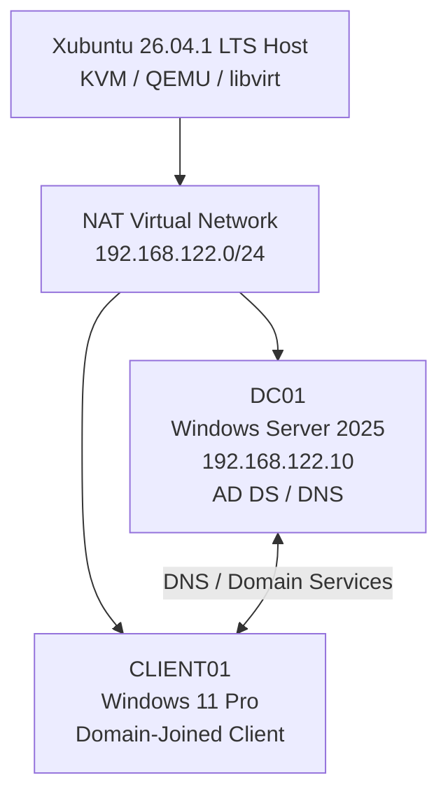

# IT Operations Home Lab

A personal IT Operations home lab built to practice and demonstrate foundational IT infrastructure administration, Windows Server management, Active Directory, DNS, Group Policy, and network file sharing.

## Project Overview

This project simulates a small business IT environment using virtual machines hosted on a Linux-based virtualization platform.

The lab consists of a Windows Server 2025 domain controller and a Windows 11 client workstation. It demonstrates how centralized user and computer management, domain authentication, departmental access control, and automated network drive mapping can be implemented in a Windows domain environment.

The project was designed as a hands-on learning exercise to develop practical skills relevant to entry-level IT Operations, IT Support, and IT Infrastructure roles.

## Lab Architecture

The environment uses KVM/QEMU virtualization with a NAT-based virtual network.



## Technologies and Tools

| Category | Technologies |
|---|---|
| Host Operating System | Xubuntu 26.04.1 LTS |
| Virtualization | KVM, QEMU, libvirt, virt-manager |
| Server Operating System | Windows Server 2025 Standard Evaluation |
| Client Operating System | Windows 11 Pro |
| Directory Services | Active Directory Domain Services (AD DS) |
| Name Resolution | DNS |
| Policy Management | Group Policy Management |
| File Sharing | SMB |
| Network Configuration | IPv4, DHCP, NAT |
| Documentation | Markdown, Microsoft Word, PDF |
| Version Control | Git, GitHub |

## Implemented Features

### 1. Active Directory Domain Services

- Installed and configured the Active Directory Domain Services role.
- Promoted Windows Server 2025 to a domain controller.
- Created a new Active Directory forest using `corp.test`.
- Organized users, computers, and security groups into departmental Organizational Units (OUs).
- Created and managed domain user accounts.
- Created Global Security Groups for IT, HR, and Finance departments.
- Practiced account administration, including password resets and enabling/disabling accounts.

### 2. DNS Configuration

- Configured DNS as part of the domain controller setup.
- Verified domain name resolution from the domain controller and client workstation.
- Tested domain controller hostname resolution.
- Verified Active Directory service records using DNS queries.

### 3. Group Policy Management

- Created separate Group Policy Objects (GPOs) for IT, HR, and Finance.
- Linked each GPO to its corresponding departmental Users OU.
- Configured automated network drive mapping through Group Policy Preferences.
- Verified that the appropriate drive mappings were applied to domain users.

### 4. Network File Sharing and Access Control

- Created departmental shared folders for IT, HR, and Finance.
- Configured SMB network sharing.
- Applied department-specific NTFS permissions.
- Configured share-level permissions.
- Tested authorized and unauthorized folder access using different domain accounts.
- Verified that users could access their own departmental folders but were denied access to other departments' folders.

## Validation and Testing

The lab was tested using the Windows 11 client workstation joined to the `corp.test` domain.

| Test | Expected Result | Status |
|---|---|---|
| Domain Controller DNS Resolution | DC01 resolves to 192.168.122.10 | Passed :white_check_mark: |
| Domain Name Resolution | corp.test resolves successfully | Passed :white_check_mark: |
| Domain Join | CLIENT01 successfully joins corp.test | Passed :white_check_mark: |
| Domain User Authentication | Departmental accounts can sign in | Passed :white_check_mark: |
| IT Drive Mapping | IT user receives I: drive | Passed :white_check_mark: |
| HR Drive Mapping | HR user receives H: drive | Passed :white_check_mark: |
| Finance Drive Mapping | Finance user receives F: drive | Passed :white_check_mark: |
| Departmental File Access | Users can access their assigned folders | Passed :white_check_mark: |
| Unauthorized File Access | Users are denied access to other departments' folders | Passed :white_check_mark: |

All listed tests were successfully performed in the lab environment.

## Repository Structure

```text
IT-Operations-Home-Lab/
├── Documentation/
│   ├── 1.0-Network-Architecture.md
│   ├── 2.0-Active-Directory-and-DNS.md
│   └── 3.0-Group-Policy-and-File-Sharing.md
├── Final-Report/
│   ├── IT-Operations-Home-Lab-Report.docx
│   └── IT-Operations-Home-Lab-Report.pdf
├── Screenshots/
│   ├── Virtualization/
│   ├── Active-Directory/
│   ├── Group-Policy/
│   └── File-Sharing/
└── Troubleshooting/
    └── Troubleshooting-Log.md
```
## Documentation and Reports

Detailed documentation and project reports are available below:

- [Network Architecture](Documentation/1.0-Network-Architecture.md)
- [Active Directory and DNS Configuration](Documentation/2.0-Active-Directory-and-DNS.md)
- [Group Policy and File Sharing](Documentation/3.0-Group-Policy-and-File-Sharing.md)
- [Troubleshooting Log](Troubleshooting/Troubleshooting-Log.md)
- [Final Project Report (PDF)](Final-Report/IT-Operations-Home-Lab-Report.pdf)
- [Final Project Report (DOCX)](Final-Report/IT-Operations-Home-Lab-Report.docx)

## Project Limitations

- This is a personal learning environment, not a production enterprise network.
- Virtual machines operate on a NAT-based virtual network.
- The lab uses evaluation editions of Windows Server and Windows 11 Pro.
- The environment is limited by the host laptop's available memory and processing resources.
- The domain and user accounts are fictional and intended solely for lab exercises.


